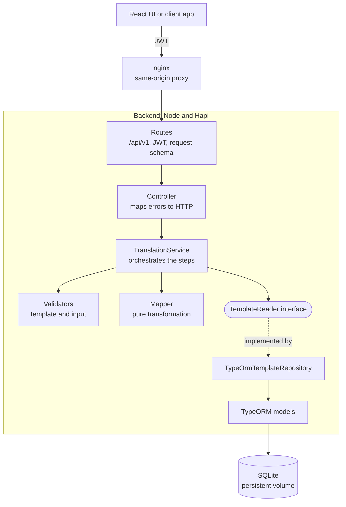
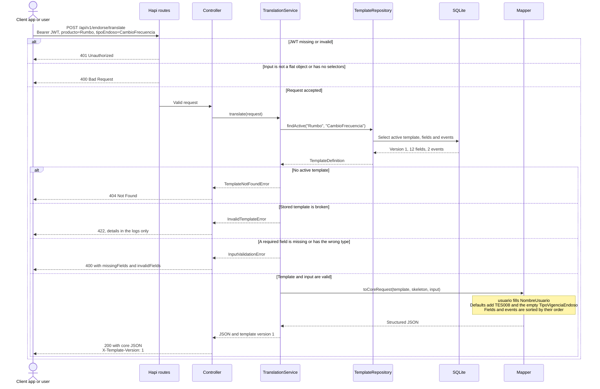
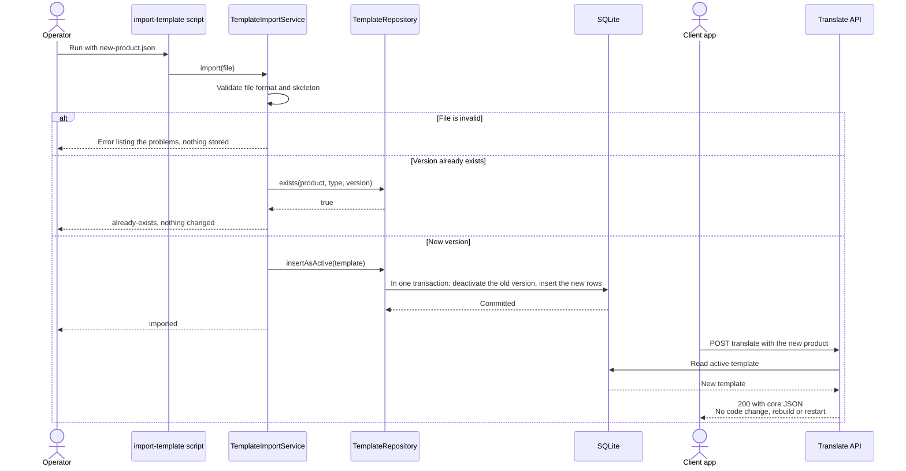

# Architecture

The data model and its ER diagram are in [database-model.md](database-model.md).

## Layers

These follow the PDF's architecture diagram. Integration and Publisher are left out, because this service doesn't call external APIs or publish to a broker.

## Translating a request

A concrete example with the PDF's Rumbo request. Required fields, defaults and order all come from the database, so nothing in this flow is specific to Rumbo.

The service only returns the JSON. Sending it to the core is outside this service's scope ([A-002](assumptions.md)).

## Adding a product without code

The main requirement of the exercise: a new product is published as data, with no rebuild or restart.

