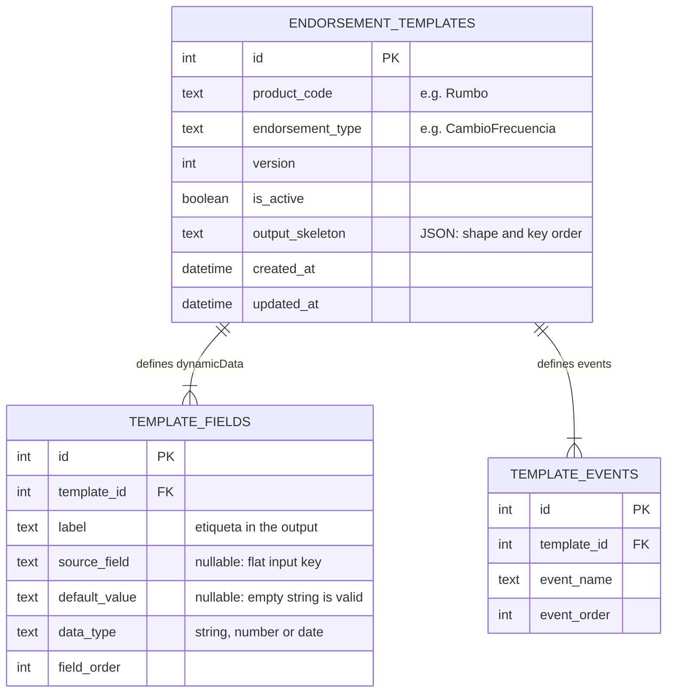

# Database model

Three tables. What varies per product and endorsement type (labels, order, defaults, events) gets real rows and constraints. The output's shape rarely changes, so it stays a JSON document on the template. See [ADR-001](adr/001-relational-rows-plus-json-skeleton.md).

## What a field row means

"Required" is derived rather than stored, so a required field with a default can't exist.

| `source_field` | `default_value` | Meaning | Example |
|---|---|---|---|
| set | `NULL` | **Required**: missing means 400 | `NombreUsuario` from `usuario` |
| set | set | **Optional**: default used if not sent | `CanalAtencion` in the demo template |
| `NULL` | set | **Fixed value** | `EndososSimplesSACRumbo` = `TES008` |
| `NULL` | `NULL` | **Invalid**: blocked by a `CHECK` | n/a |

`NULL` means no default and `''` is a real default, which is what `TipoVigenciaEndoso` needs.

## Constraints the diagram can't show

| Rule | Enforced by |
|---|---|
| One active version per product and endorsement type | Partial unique index `uq_one_active_template` |
| No duplicate versions | `uq_template_version` |
| Unambiguous order | `uq_field_order`, `uq_event_order` |
| No repeated label in a template | `uq_field_label` |
| Every field can get a value | `ck_field_has_value_source` |
| Skeleton is valid JSON | `CHECK (json_valid(output_skeleton))` |
| Fields and events go with their template | `ON DELETE CASCADE` |

The schema is in [the migration](../backend/src/database/migrations/1730000000000-create-template-schema.ts).

## The Rumbo rows

`template_fields`:

| `field_order` | `label` | `source_field` | `default_value` | `data_type` |
|---|---|---|---|---|
| 1 | ProductosVida | producto | | string |
| 2 | NombreUsuario | usuario | | string |
| 3 | NumeroPolizaEndoso | policyNumber | | string |
| 4 | TipoEndosoPol | | Endoso Simple | string |
| 5 | ResponsableAtencion | | SAC | string |
| 6 | EndosoModifPrima | | Si | string |
| 7 | InicioVigenciaEndoso | | Default | string |
| 8 | TipoVigenciaEndoso | | `''` | string |
| 9 | EndososSimplesSACRumbo | | TES008 | string |
| 10 | FechaSolicitud | fechaSolicitud | | date |
| 11 | FechaCliente | fechaCliente | | date |
| 12 | FechaEfectiva | fechaEfectiva | | date |

`template_events`: `SolicitarEndoso` (1), `AprobarEndoso` (2).

## The skeleton

Plain JSON that fixes nesting and key order, with two kinds of placeholder. Each fills a whole value:

- `{{source}}` or `{{source|number}}`: a required input value, optionally type-checked. The input's type is kept, so `idEnvio` stays a number.
- `{{$dynamicData}}` and `{{$events}}`: the ordered lists built from the rows above.

Anything else is copied literally. Other uses of `{{` are rejected as invalid configuration.

## Known limits

- Skeleton placeholders are always required and can't have defaults. A value that needs a default has to be a field row.
- Templates with the same shape each hold their own skeleton copy. A shared table is the next step if that becomes a burden.
- Product codes are plain strings, on the assumption that the product catalog is owned elsewhere.
